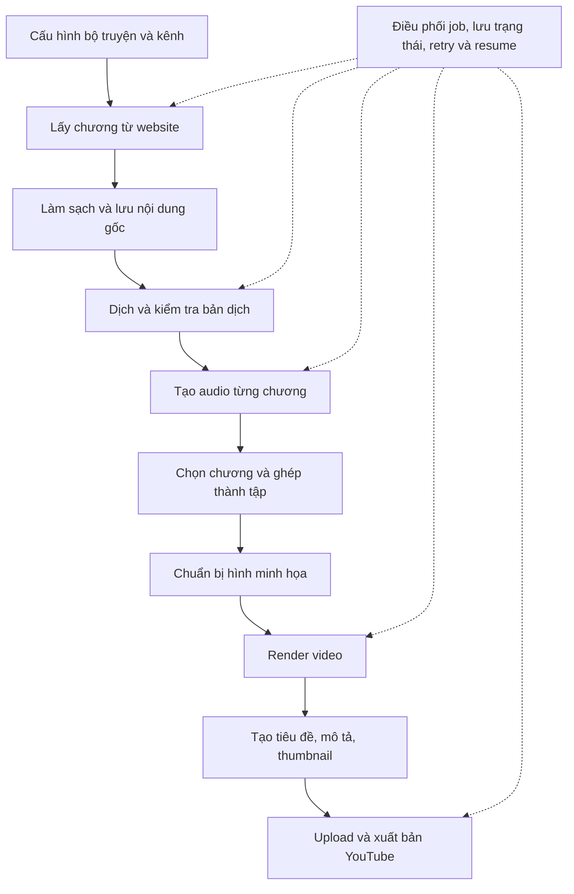

# Roadmap phát triển novel2voice

## 1. Tầm nhìn

Biến novel2voice thành hệ thống sản xuất và xuất bản video truyện tự động từ A–Z:

**Fetch truyện từ web → Làm sạch nội dung → Dịch truyện → Tạo audio → Ghép chương thành tập → Ghép audio và hình minh họa thành video → Publish lên YouTube theo cấu hình.**

Các module dịch và TTS hiện tại là phần lõi của hệ thống. Phát triển theo từng mốc có thể chạy được từ đầu đến cuối, thay vì hoàn thiện tất cả module rồi mới tích hợp.

## 2. Bức tranh toàn cảnh

## 3. Các đơn vị quản lý

| Đơn vị | Vai trò |
|---|---|
| Bộ truyện | Nguồn web, ngôn ngữ, glossary, nhân vật, phong cách dịch |
| Chương | Nội dung gốc, bản dịch, audio và trạng thái xử lý |
| Đoạn | Đơn vị xử lý nhỏ cho dịch hoặc TTS, hỗ trợ checkpoint và chạy lại |
| Tập video | Danh sách chương, audio ghép, hình ảnh, video và metadata |
| Kênh | Giọng đọc mặc định, mẫu hình ảnh, mẫu metadata, cấu hình xuất bản |
| Job | Một lần xử lý, tiến độ, lỗi, mức sử dụng dịch vụ và kết quả |

Một bộ truyện có nhiều chương; một tập video chứa một hoặc nhiều chương. Tách chương khỏi tập video để có thể thay đổi cách chia tập mà không phải dịch hoặc tạo audio lại.

## 4. Roadmap triển khai

### Giai đoạn 1 — Nền tảng vận hành bền vững

Xây nền tảng trước khi nối thêm các bước tự động.

- Lưu trạng thái truyện, chương, đoạn và job bằng SQLite.
- Chuẩn hóa cấu hình theo bộ truyện và kênh.
- Thêm resume, retry, kiểm tra đầu ra và lưu lỗi.
- Tái sử dụng kết quả khi nội dung và cấu hình không thay đổi.
- Giữ kết quả trung gian để sửa hoặc chạy lại từng bước.
- Ghi kết quả qua file tạm, chỉ đánh dấu hoàn thành sau khi kiểm tra thành công.
- Thêm kiểm tra môi trường và test các tình huống thất bại quan trọng.
- Khi người dùng dừng chương trình, lưu trạng thái trước khi thoát.

**Mốc hoàn thành:** đưa một thư mục TXT vào, hệ thống tạo audio cho cả bộ truyện; bị ngắt giữa chừng vẫn tiếp tục được và tái sử dụng các đoạn đã hoàn thành.

### Giai đoạn 2 — Tự động lấy truyện từ web

Xây lớp adapter cho từng website, bắt đầu với một nguồn cụ thể.

- Nhận URL bộ truyện và lấy danh sách chương.
- Fetch nội dung, loại menu, quảng cáo và phần không thuộc truyện.
- Lưu URL nguồn, số chương, tiêu đề, nội dung và thời điểm lấy.
- Phát hiện chương trùng, chương thiếu hoặc nội dung thay đổi.
- Đồng bộ chương mới theo yêu cầu; bổ sung lịch chạy ở giai đoạn sau.
- Có giới hạn tốc độ và xử lý lỗi nguồn.
- Giữ nội dung gốc riêng để khi đổi prompt dịch không phải fetch lại.

**Mốc hoàn thành:** nhập URL truyện, hệ thống lấy chương và đưa vào luồng dịch/TTS hiện có.

### Giai đoạn 3 — Hoàn thiện dịch và audio cho truyện dài

Nâng chất lượng và khả năng kiểm soát trước khi sản xuất video hàng loạt.

- Hồ sơ truyện: bối cảnh, nhân vật, cách xưng hô và glossary.
- Truyền ngữ cảnh phù hợp giữa các đoạn dịch.
- Lọc glossary theo nội dung để giảm kích thước prompt.
- Kiểm tra bản dịch rỗng, bị cắt hoặc có dấu hiệu thiếu nội dung.
- Cho phép chỉnh bản dịch và tạo lại audio liên quan.
- Cấu hình giọng, tốc độ, cách đọc tên riêng và khoảng nghỉ.
- Tách cấu hình chia đoạn dịch khỏi cấu hình chia đoạn TTS.
- Kiểm tra audio từng đoạn và từng chương, bảo đảm đủ đoạn và đúng thứ tự.
- Ghi nhận thời gian xử lý và mức sử dụng dịch vụ.

**Mốc hoàn thành:** từ chương trên web tạo được bản dịch và audio nhất quán, có thể sửa và chạy lại từng chương.

### Giai đoạn 4 — Đóng gói chương thành tập audiobook

Thêm bước riêng để quyết định video sẽ chứa những chương nào.

- Chia tập theo số chương, thời lượng mục tiêu hoặc lựa chọn thủ công.
- Ghép audio chương theo thứ tự.
- Thêm mở đầu, kết thúc và khoảng nghỉ nếu cấu hình yêu cầu.
- Lưu mốc thời gian bắt đầu của từng chương.
- Đặt tên tập và theo dõi chương đã được đưa vào tập nào.
- Khi bổ sung chương mới, giữ nguyên các tập đã xuất bản.
- Khi ghép lỗi, chạy lại bước ghép mà không tạo lại audio chương hợp lệ.

**Mốc hoàn thành:** hệ thống tạo các tập audio hoàn chỉnh cùng danh sách chương và timestamp.

### Giai đoạn 5 — Tạo video và bộ nội dung xuất bản

Bắt đầu bằng mẫu video đơn giản: audio + ảnh nền + tiêu đề tập.

- Nhận ảnh có sẵn hoặc lấy từ thư viện hình của bộ truyện.
- Render video bằng FFmpeg theo mẫu cấu hình.
- Tạo thumbnail, tiêu đề, mô tả và timestamp chương.
- Kiểm tra video có audio, thời lượng phù hợp và render hoàn chỉnh.
- Sau đó mở rộng sang nhiều ảnh, chuyển cảnh, phụ đề hoặc hình minh họa được tạo tự động.
- Ảnh tạo tự động là một provider tùy chọn; pipeline vẫn chạy được với ảnh chuẩn bị sẵn.

**Mốc hoàn thành:** từ một tập audio tạo ra bộ file sẵn sàng upload: video, thumbnail và metadata.

### Giai đoạn 6 — Tích hợp xuất bản YouTube

Đưa bộ nội dung đã hoàn thành lên kênh theo cấu hình.

- Kết nối tài khoản và chọn kênh.
- Upload video, thumbnail và metadata.
- Hỗ trợ cấu hình chế độ hiển thị và lịch xuất bản.
- Lưu ID video cùng trạng thái upload/xuất bản.
- Ngăn upload trùng khi retry hoặc chạy lại job.
- Ban đầu có bước duyệt trước khi xuất bản; sau khi vận hành ổn định, bật chế độ tự động theo cấu hình.

**Mốc hoàn thành:** một tập hoàn thành được upload và xuất bản, có đường dẫn kết quả và lịch sử rõ ràng.

### Giai đoạn 7 — Vận hành tự động từ A–Z

Bổ sung khả năng chạy lâu dài mà ít cần can thiệp.

- Theo dõi chương mới theo lịch.
- Tự tạo tập khi đủ số chương hoặc thời lượng.
- Điều phối fetch, dịch, TTS, render và upload qua hàng đợi.
- Giới hạn tài nguyên máy, ngân sách và số job đồng thời.
- Thông báo khi cần can thiệp hoặc khi xuất bản thành công.
- Dashboard quản lý nhiều truyện và nhiều kênh.
- Chính sách lưu trữ, sao lưu và dọn dữ liệu sau xuất bản.

**Mốc hoàn thành:** cấu hình một bộ truyện và kênh một lần; hệ thống tự xử lý chương mới, tạo tập và xuất bản theo lịch.

## 5. Kiến trúc định hướng

Tiếp tục dùng Python, giữ các module dịch/TTS đang có và tách thêm các nhóm chức năng:

| Nhóm | Trách nhiệm |
|---|---|
| `sources` | Adapter website, lấy và làm sạch chương |
| `translation` | Dịch, glossary, ngữ cảnh, kiểm tra |
| `speech` | TTS provider, chia đoạn, kiểm tra audio |
| `episodes` | Chia tập, ghép audio, timestamp |
| `visuals` | Ảnh minh họa, thumbnail |
| `video` | Mẫu video và render |
| `publishing` | Metadata, upload, trạng thái xuất bản |
| `orchestration` | Job, trạng thái, retry, resume, lịch chạy |

Ban đầu dùng một ứng dụng Python + SQLite + thư mục lưu artifact. Khi cần nhiều worker hoặc nhiều máy, mới nâng cấp hàng đợi và cơ sở dữ liệu. Mọi bước nên có thể gọi riêng bằng CLI để dễ kiểm tra và sửa lỗi.

## 6. Phạm vi phiên bản tự động đầu tiên

**Một website → Một bộ truyện → Một giọng đọc → Chia tập theo số chương → Một ảnh nền → Một kênh YouTube.**

Phiên bản này đi đủ A–Z, nhưng phạm vi mỗi bước nhỏ. Sau khi chạy ổn định, mở rộng nguồn truyện, chất lượng hình ảnh, cách chia tập và số kênh.

## 7. Bước triển khai đầu tiên

Bắt đầu từ giai đoạn 1: mô hình dữ liệu và bộ điều phối có resume.

Đợt triển khai đầu tiên tập trung vào TTS truyện dài:

1. Lưu trạng thái từng đoạn và dấu vết nội dung/cấu hình.
2. Giữ kết quả đã hoàn thành khi lỗi hoặc bị ngắt.
3. Hỗ trợ tiếp tục job và chạy lại đoạn thất bại.
4. Kiểm tra số lượng, tính hợp lệ và thứ tự audio trước khi ghép.
5. Báo cáo chương thành công, thất bại và chưa xử lý.

Đây là nền móng để các bước fetch, dịch, render và publishing nối vào mà không phải xây lại pipeline mỗi khi thêm chức năng mới.
